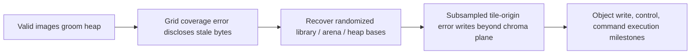

# Assignment: libheif memory-safety chain

> Source: [assignment handout](https://compsec.kisp-lab.org/Memory-Safety-Webbook/assignment.html). Reference to the brief, not a solution. Current Canvas and supplied `README.md`/service source govern submission and grading.

## Objective, environment, rules ([overview](https://compsec.kisp-lab.org/Memory-Safety-Webbook/assignment.html#overview))

- Exploit libheif 1.21.2 in a thumbnail service: uploaded HEIF → decoded binary PPM image. Two bugs: CVE-2026-47247, uninitialized grid output disclosing recycled allocation bytes; CVE-2026-47178, incorrectly scaled tile origin causing out-of-bounds chroma-plane writes. Combine disclosure and write for command execution. ASLR, PIE, NX, canaries, shadow-stack support, full RELRO stay enabled.
- Control: bytes and ordering of uploaded files. Observe: PPM, error, or connection close. No graded-service debugger, `/proc`, filesystem or side channel. Handout includes fixing patches; develop measurements on supplied local build. C, x86-64 and GDB assumed.

- Individual work; no sharing assignment-specific solutions. Handout says AI discouraged but permitted under linked [NUS policy](https://ctlt.nus.edu.sg/wp-content/uploads/2026/09/NUS-AI-Teaching-Learning-Policy_15-Sept-2026.pdf) if every prompt and response goes into `report.pdf`; cite *every external source* with 1–2 sentences about its contribution (lecture/webbook exempt). Earlier introduction conflicts (says no AI on Part I assessments); verify with Canvas/course staff first. Private Canvas channel for assignment questions.
- Submit `EXXXXXXX.zip` containing a student-ID folder with exactly `run.py` (completed `exploit/run.py`) and `report.pdf`. Report mandatory: absent costs 10/100; if no external sources or AI, use specified declaration in original handout. Accepting optional helper-access agreement costs 20/100 once, whether tools are used or not; merely viewing it costs nothing. Deadline/weight: Canvas.

## Setup and scoring ([getting started](https://compsec.kisp-lab.org/Memory-Safety-Webbook/assignment.html#start))

- Download [assignment.zip](https://compsec.kisp-lab.org/assignment/assignment.zip) (129 MB; [SHA-256](https://compsec.kisp-lab.org/assignment/assignment.zip.sha256)); Vagrant provisions prebuilt vulnerable/fixed/sanitizer builds; no source compilation needed. Install Vagrant and VirtualBox (Windows/Linux/Intel Mac) or QEMU plugin (Apple Silicon); run `vagrant up`, `vagrant ssh`. QEMU `/vagrant` is a one-way host copy: edit on host, then `vagrant rsync`; VirtualBox shares live.
- In VM: `exploit/run.py` is the only editable file for grading; `lib/heif_format.py` file builder, `lib/heif_service.py` connection, `lib/grader.py` address reports, `patches/` two fixes, `service/heif-service.c` authoritative checks, `README.md`, `bin/grade`; `/opt/heif-gap` contains multiple builds/sources. Do not alter libraries/tools/service/build config.
- `grade exploit --rounds 1` quick feedback; `grade exploit --rounds 10` full run. Each round is a fresh service with new addresses, token, target, leak length and write distance. Each rung independently awards its points if reached in at least one round of the same invocation. Scores do not accumulate between invocations; later rungs can be probabilistic. Untouched skeleton scores zero. Handout overview mentions “12 tasks” but detailed rubric has 11 scored rungs (tasks 9–11 grouped).

## Overflow: CVE-2026-47178 ([tasks 1–2](https://compsec.kisp-lab.org/Memory-Safety-Webbook/assignment.html#t1))

- Planes store rows sequentially: `row(r) = plane + r * stride`. 4:2:0: full-resolution Y and separate half-width/half-height Cb, Cr allocations (8×8 Y → 4×4 chroma). Tiles use full-resolution origin; chroma dimensions are already scaled. Vulnerable `decoder_component_interleave.cc` computes destination with `out_y0 + y` and `out_x0`; fix uses `out_y0/sub_y + y`, `out_x0/sub_x` (`sub_x=sub_y=2` for 4:2:0). Second tile row at full-resolution row 4 belongs at chroma row 2, not row 4 beyond the plane. Single tile row at origin zero does not trigger. Fixed decoder yields identical image across equivalent tilings.
- 1 `overflow()` (10): return 4:2:0 file triggering at least one out-of-bounds chroma row; supplied `unci_420(w,h,tile_cols=1,tile_rows=1)` builds uncompressed item (`unci`, raw `mdat`, property boxes; experimental codec enabled).
- 2 `write_placed(write_distance)` (6): dynamically place first *fully* out-of-bounds row start exactly `write_distance` bytes beyond allocation end (later rows ignored). `add_plane` adds 15 alignment-slack bytes after a row boundary, hence `distance = stride - 15` and chroma width = half full-resolution width.

Plane origin, stride, and the first external row

- For a plane with start `P` and stride `S`, row *r* starts at `P + r*S`; width is logical samples per row, while stride is the actual distance between row starts and can include padding. Y, Cb and Cr have different allocations, so the correct output row must be computed in each plane's coordinate system.
- At 4:2:0, tile origin `(out_x0,out_y0)` is in Y/full-resolution coordinates, but chroma uses half-resolution coordinates. Dividing the origin by `(sub_x,sub_y)` before applying stride is the missing operation; the tile's chroma width/height were already divided, so dividing those twice would be wrong.
- The grading distance is measured from allocation end to the beginning of the first row wholly beyond it, not from the last written byte. With 15 alignment-slack bytes after a boundary, that next start is `S - 15` bytes past the end; do not confuse the row's logical width with `S`. This describes the handout's allocator behavior, not an HEIF format invariant. [Overflow and placement](https://compsec.kisp-lab.org/Memory-Safety-Webbook/assignment.html#t2).

## Disclosure: CVE-2026-47247 ([tasks 3–4](https://compsec.kisp-lab.org/Memory-Safety-Webbook/assignment.html#t3))

- `grid` output canvas references decoded tiles. Vulnerable `grid.cc` compares tile dimensions to `canvas_width/columns` and `canvas_height/rows` using truncating division; fix checks `src_width * columns < canvas_width` etc. Example: three 4-pixel tiles cover 12; width 13 or 14 passes (`/3 = 4`) despite gap; 15 rejects (`/3 = 5`). Gap constraints: `gap_c < cols`, `gap_r < rows`; need >1 column/row for respective gap. `pixelimage.cc` allocates output without initializing uncovered pixels.
- 3 `groom()` + `probes()` (6): grid factory `grid(cols,rows,tw,th,gap_c=0,gap_r=0,fill=0x41)` gives output width `W=cols*tw+gap_c`, height `H=rows*th+gap_r`, RGB 3 bytes/pixel. Filled tiles all known byte; differing output can be residual data. Fresh kernel pages may be zero: valid grooming decodes allocate/free planes before gap probes on same connection/child process, establishing heap history. Grader detects uninitialized region via two allocator-fill patterns even without grooming, but address rungs require it.
- 4 `gap_sized(leak_len)` (5): produce exact requested uninitialized bytes: `uncovered_pixels = gap_r*W + gap_c*(H-gap_r)`; `leak_len = 3*uncovered_pixels`. Uncovered right columns and bottom rows need not be contiguous; choose dimensions satisfying acceptance check.

Where the grid leaves uninitialized pixels

- If tiles cover `C=cols*tw` by `R=rows*th`, the declared canvas is `W=C+gap_c`, `H=R+gap_r`. Its uncovered area is all bottom `gap_r` rows (`gap_r*W`) plus `gap_c` right-hand pixels in each of the other `H-gap_r` rows. Count each pixel once, then multiply by three RGB bytes.
- For `cols=3`, `tw=4`, `gap_c=2`, `W=14`, integer division says `14/3=4` and the vulnerable check accepts 4-pixel tiles although their true coverage is 12. A width of 15 gives `15/3=5` and rejects. For example `W=14`, `H=9`, 96 covered pixels leaves 30 uncovered = 90 leaked RGB bytes; PPM header bytes are not part of `leak_len`.
- A right-edge gap occurs at the end of each covered row in row-major output; a bottom gap occupies later full rows. In returned PPM data the uninitialized bytes are not necessarily one continuous slice. [Gap and sizing](https://compsec.kisp-lab.org/Memory-Safety-Webbook/assignment.html#t4).

## Derive addresses ([tasks 5–8](https://compsec.kisp-lab.org/Memory-Safety-Webbook/assignment.html#t5))

| Rung | Points | Required inference |
|---|---:|---|
| 5 `libheif_base(v)` + `bases_in_image()` / `OFFSETS_FROM_LIBHEIF_BASE` | 11 | Validate candidate 8-byte pointer and subtract locally measured fixed offset within library; deinterleave PPM RGB using `planes()` because same internal channel bytes are 3 bytes apart in returned image. |
| 6 `arena_base(v)` | 9 | Recognize pointer into a glibc thread arena; return base of any arena in child process. Four libheif workers decode tiles. |
| 7 `heap_bases(v)` + `heap_winner()` / `HEAP_PAGES` | 6 | Reject mmap/non-main-heap pointers; page-align candidate, subtract each known grooming-page offset, vote across multiple leaks; return only strict plurality/lead, not from single pointer. Probabilistic. |
| 8 `find_bases()` / `LIBC_DELTAS` | 5 | No direct libc pointer: apply locally measured constant loader displacement between libheif and libc for supplied build/library set. Do not assume it holds on unrelated machines. |

- ASLR changes executable/library/heap/thread-arena bases per child; fixed *within-build* offsets and observed leak pointers recover current bases. Compare against actual maps only in permitted local environment.

## Final stage ([tasks 9–11](https://compsec.kisp-lab.org/Memory-Safety-Webbook/assignment.html#final))

- `object_write` 14, `pc_control` 13, `ace` 15 = 42 points; functions `_place_in_plane()`, `scaffold()`, `object_write()`, `pc_control()`, `arena_candidates()`, `ace()`. Combine earlier primitives; discover own layout/payload/validation using supplied local sources and service. Independently scored; assignment deliberately leaves details to student investigation.
- Total: overflow 16 + gap 11 + addresses 31 + final 42 = 100. References, fixed patches and advisories are linked in the [handout](https://compsec.kisp-lab.org/Memory-Safety-Webbook/assignment.html#references).
