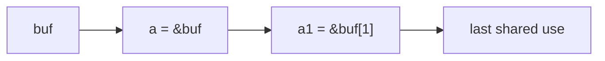
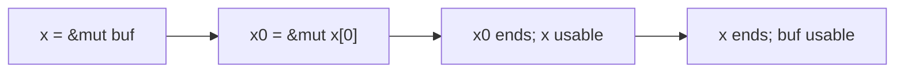

# Memory vulnerabilities cheatsheet

## Systems facts to remember

- Spatial error: access outside an object's intended bounds (wrong place). Temporal error: access outside its lifetime (wrong time).
- A memory leak wastes storage; it is not itself an invalid access. An in-bounds read through a stale pointer is still UAF.
- Scope concerns where a *name* is visible; lifetime concerns when the *object* exists. A pointer can remain in scope after its pointee dies.
- Dangling-pointer use and double-free are undefined behavior (UB). A seemingly successful run proves nothing about the next one.
- Build: source → compiler → assembly → assembler → object → linker → executable → loader → process. Only the finished artifacts/loader are needed at program startup.

| x86 register | 32-bit | 64-bit | Meaning |
|---|---|---|---|
| Instruction pointer | `eip` | `rip` | Address of next instruction |
| Stack pointer | `esp` | `rsp` | Current stack top |
| Frame pointer | `ebp` | `rbp` | Frame anchor when retained by compiler |

- x86 uses little-endian integers: bytes `41 42 43 44` in ascending addresses decode to `0x44434241`.
- Stack allocation grows to lower addresses. A forward overflow from a local buffer often writes toward higher addresses, where saved control data may reside.
- `call` pushes the return address and jumps. The callee may save the old frame pointer. `ret` pops the return address into `eip`/`rip`.
- Saved-frame-pointer slots, source-order local layouts and even stack-resident locals are not guaranteed; optimization can remove or reorder them.
- Linux x86-64 System V integer/pointer arguments: `rdi, rsi, rdx, rcx, r8, r9`, then stack; return usually in `rax`. On entry after an ordinary `call`, `rsp % 16 == 8`.
- Linux i386 arguments go on the stack right to left. Microsoft x64 begins with `rcx, rdx, r8, r9`. Do not transfer an i386 ret2libc diagram's stack-argument placement to x86-64.
- `/proc/<pid>/maps` permissions: `r-xp` often code, `rw-p` heap/stack/data, `r--p` read-only mapping. Filename and mapping labels distinguish regions with the same permissions.
- Accessing an unmapped address causes a CPU page fault. The kernel handles it and may signal `SIGSEGV`.
- `scanf("%d", ...)` needs `int *`: `&a`, allocated `int *b`, or `int c[1]` (decays to `&c[0]`) work. `a` is not a pointer; `&b` and `&c` have the wrong pointer types.
- A 100 × 50 `int **x`: allocate 100 `int *` slots, then 50 `int` per row; free rows before `x`. One flat `int` allocation is not an `int **`.
- `sizeof array` gives total array bytes only where the array type is still known; a parameter declared `char buf[]` is adjusted to `char *`, so `sizeof buf` there measures the pointer. Pass the capacity separately.
- Address arithmetic in a diagram is not C pointer arithmetic permission: C permits a pointer within its array object or one past it, not arbitrary offsets across adjacent allocations. Debugger addresses can describe where a bad write landed without making it defined behavior.

## Security reasoning

- Threat model: record starting state, trusted assumptions, attacker capabilities, and attacker goal. A defense claim applies only under those assumptions.
- Compare attack cost per victim with defense cost. A defense can be useful without making exploitation impossible, provided it raises the attacker's cost enough.
- A crash is not evidence of successful exploitation. A successful data-only change or forged dispatch may finish without a crash.
- Classify a case by the first invalid operation and the eventual effect separately: an out-of-bounds read can be a disclosure; an out-of-bounds write can alter data or control; a stale-pointer read can disclose a new occupant of reused storage.
- For each proposed defense, ask which exact step it blocks: constructing an invalid pointer, performing the access, locating a target, transferring control, or executing injected bytes. “The program still crashes” is not the same as “the vulnerability was removed.”

## Stack and input boundaries

- `scanf("%s", buf)` reads non-whitespace characters and then writes a NUL at `buf[input_length]`.
- `char buf[50]`: `%49s` accepts at most 49 characters plus NUL. 50 characters overflow by the NUL alone.
- `fgets(buf, sizeof buf, stdin)` knows the available space. `gets` has no bound and was removed from C11.
- `strncpy` does not guarantee NUL termination after truncation; a later `strlen` may continue beyond the destination.
- `strncat(dst, src, n)`: `n` is the maximum number of *appended* bytes. Account for existing content and terminating NUL.
- `snprintf` returns how many characters would have been written, excluding NUL. A truncated return value may exceed the actual stored length.
- A stack canary may catch a contiguous write on the way to saved RIP, but a nearby privilege flag may be corrupted without touching it.
- With raw payloads, account for little-endian address bytes and any automatic NUL written *after* the input; typed text often cannot carry embedded zero bytes.
- For an `N`-byte buffer filled by an unbounded `%s`, the first out-of-bounds write occurs at input length **N** (the terminating NUL). At length `N+1`, the first nonzero input byte is out of bounds. A nearby target's offset determines whether the NUL or controlled byte reaches it first.
- A width on `%s` limits characters, not total stored bytes: `%Ns` still requires **N+1** bytes of destination space. By contrast, `fgets` takes the complete destination capacity; if it reads a newline, that newline occupies one of the stored character slots.
- `read(fd, buf, n)` does not append a NUL and may return fewer than `n` bytes; code treating its bytes as a string must track the returned count and reserve room to terminate. `memcpy` copies exactly its requested byte count, not until a terminator.

## Format strings and integer sizes

- `printf(user)` treats user bytes as conversions. Use `printf("%s", user)` so they remain data.
- `%x`/`%lx` prints fetched argument words; `%s` dereferences a fetched pointer and prints from there (or faults).
- `%n` prints nothing; it writes the characters emitted so far by that *same* `printf` through a fetched pointer. A pointer to the target is needed, not the target's stored value.
- `%m$...` selects one-based variadic argument position `m`; `%8$s` reads a string at the pointer in slot 8. The format pointer in `rdi` is not a variadic slot.
- On System V x86-64 the first five `printf` variadic integer/pointer args occupy `rsi, rdx, rcx, r8, r9`, then stack slots. A call supplying no such args makes speculative conversions UB; observed slots belong to that compiled binary.

| Conversion | Destination pointer | Typical bytes written |
|---|---|---:|
| `%hhn` | `signed char *` | 1 |
| `%hn` | `short *` | 2 |
| `%n` | `int *` | 4 |
| `%ln` | `long *` | 8 on x86-64 Linux |

- `%hhn`/`%hn` write low 8/16 bits of the count. Include all output from the same call when calculating padding; avoid mixing positional and non-positional conversions.
- For example, to store `0x1337` (4919) with `%n`, arrange 4919 printed characters before the write conversion, then use a slot holding the destination's address. Output printed by an earlier `printf` does not count.
- A marker such as `MARK` can identify where controlled bytes appear in argument words: ASCII `4d 41 52 4b` appears as `0x4b52414d` when interpreted little-endian. Measure positions in the actual binary.
- `%016lx` prints an 8-byte word as 16 zero-padded hex digits; `%8$lx` reads positional argument 8. `%8$s` instead treats that slot as a pointer to a string, which can fault if it is invalid.
- Output width is a *minimum*, not a cap: `%016lx` can print more than 16 digits only if the converted value needs them (an `unsigned long` on ordinary x86-64 does not); a `%s` width pads but does not truncate a long string. A precision such as `%.8s` limits bytes read for that conversion, subject to a valid pointer.
- For `%hhn`, a desired byte `t` needs a running printed-character count congruent to `t (mod 256)`. If the call has already printed `c` characters, add `(t-c) mod 256` before the write; for `%hn`, use modulo 65,536. Count *actual emitted characters*, not the number of format bytes or arguments consumed.
- `%n` is a write primitive only when the variadic slot contains a writable destination pointer and the program reaches the conversion. Simply placing an address in input text does not guarantee it becomes that slot; locating slots is binary- and call-site-specific.
- Small integer operands usually promote to `int` before arithmetic. An `unsigned short` result can be narrowed only *after* a larger `int` multiplication.
- Unsigned N-bit conversion wraps modulo `2^N`; a negative signed value converted to unsigned becomes a large positive value.
- Conversion outside a signed narrow type's range is implementation-defined (or may raise an implementation-defined signal). Signed arithmetic overflow is UB; do not assume signed `char` 127 + 1 always becomes -128.
- Validate count before multiplying: `count <= SIZE_MAX / item_size` (`item_size > 0`); then use `size_t bytes = (size_t)count * item_size` consistently for allocation and writes.
- `malloc(0)` does not provide a usable object: it may return null or a non-null pointer that cannot be dereferenced.
- Lab with 16-bit `unsigned short bytes = count * 16`: `count=4095` stores 65,520; `4096` stores 0 while loop writes 65,536; `4097` stores 16 while loop writes 65,552.
- Trace an integer bug in order: operand promotions → arithmetic type/range → conversion to storage type → allocation size → loop bound and index type. Comparing the requested *count* with a byte-size limit, then narrowing the product, leaves the allocation and write counts inconsistent.
- Robust sizing also rejects counts that cannot fit the index/allocator API and handles `malloc` failure before use. For an array, `count > SIZE_MAX / sizeof *p` means multiplication would overflow `size_t`; do not rely on a wrapped product being smaller than a maximum.

## Heap layout and casts

- `malloc(n)` may provide extra allocator capacity, but the requested C object's bounds do not grow accordingly.
- A glibc chunk has `prev_size` and `size` words before its user pointer. The prior allocated chunk can use the overlapping `prev_size` area, making only the next chunk's 8-byte `size` word appear between user regions in this lab.
- Chunk sizes are aligned; raw `size` low bits encode flags. `0x41` is decimal 65, encoding size `0x40` (64) with flag 1. `0x51` encodes size `0x50` (80) plus flag 1.
- Flag bits on the lab's glibc: `PREV_INUSE=0x1` describes the *previous physical chunk*, not whether this one is allocated; `IS_MMAPPED=0x2`; `NON_MAIN_ARENA=0x4`.
- Lab example: two `malloc(50)` results can be 64 bytes apart; the first chunk's raw size word can be `0x41`. The pointer gap is a rounded chunk size, not `requested_size + fixed_header_size`.
- Physical chunk adjacency determines what an overflow reaches. Logical free-list order can differ. Allocated chunks have size metadata but no master allocated-chunk linked list.
- Freed user bytes may hold allocator links. Old doubly linked `fd/bk` unlink attacks are historical; modern small chunks often go into singly linked tcache. Do not assume a forged chunk passes current `free` consistency checks.
- Corrupted heap metadata may first be noticed at a later `malloc`/`free`, not at the overflow itself. Preserving valid size metadata can avoid a crash while still corrupting neighboring data.
- Replacing a raw size byte with ASCII `A` (`0x41`) differs from `B` (`0x42`): low flag bits change too. Alignment alone does not determine whether `free` accepts a forged size.
- `static_cast<Derived*>(base)` checks no runtime type; a plain `Base` allocation has no derived fields. The cast itself allocates nothing.
- With multiple inheritance, an upcast can add a base-subobject offset and a downcast can subtract it. An invalid downcast may point before the real object.
- A polymorphic base permits `dynamic_cast<Derived*>(base)` to check the runtime type; failure of a pointer cast returns null. Check the result before dereferencing.
- An unchecked downcast can cross the object boundary on either a read or a write. Even allocator padding after a small object does not make nonexistent derived fields valid.
- Keep three quantities distinct in heap diagrams: requested object bytes (language bounds), allocator chunk size (metadata and rounding), and address gap between returned user pointers (measured layout). Crossing the first already violates spatial safety even if the other two leave writable mapped bytes.
- A free-list link observed in freed user storage is allocator state, not a live application's pointer field. An in-bounds read from a newly allocated but uninitialized same-size object can leak those residual bytes; ASan redzones generally do not flag such an in-bounds uninitialized read.

Measured lab offsets, not C/C++ or glibc guarantees:

| Target | Useful boundary |
|---|---|
| `login` | `buf[16]`; flag at `buf+20`, saved RBP `+32`, saved RIP `+40`. With `%s`, 20 characters put the NUL on the flag; 21 nonzero characters flip it. |
| `acct` | `name[32]`, `balance+32`, `is_admin+36`, next allocation's data `+48` from account start; size word at `+40`. 37 nonzero characters set first admin byte; 48 characters put the NUL at the next object's first byte. |
| `badcast` | Actual `Base` object 4 bytes, imagined `Derived::tag` at `+8`, adjacent user allocation `+32`; 24 characters put the terminator at the neighbor's first byte. |
| Exploit labs `inject`/`reuse`/`rop` | 64-byte local buffer but saved RIP at `+88` in the pinned build. Remeasure after any flag/compiler change. |

## Temporal errors and allocator reuse

- `free(p)` ends the heap object's lifetime. It does not clear its bytes, `p`, or copies of `p`.
- `free(NULL)` is harmless. After `r=p; free(p); p=NULL`, `r` still dangles; `free(r)` is double-free and `*r` is UAF. Dereferencing `p` instead is a separate null-dereference error.
- UAF can be useful even when a new same-size object occupies the freed address: bounds of the *new* object do not make the *old* pointer valid.
- Heap grooming means arranging allocations and frees so a freed slot is reused for attacker-shaped data. A stale C++ virtual call may then read a replacement vptr.
- A real C++ vtable in `.data.rel.ro` can become read-only under RELRO. The object's own vptr may remain writable; changing it is not the same as editing the protected table.
- Double-free can place the same chunk on an allocator reuse path twice. Two returned pointers may then appear to own the same physical chunk.
- `free()` itself may overwrite former user bytes with allocator bookkeeping. It does not automatically grant an arbitrary write; an additional alias/write and allocator action are needed.
- Typical glibc tcache duplicate checks abort a simple `free(a); free(b); free(a)` when the bin has room.
- Course glibc 2.35 lab: filling that same-size tcache with 7 frees routes later `A,B,A` to fastbins; the immediate-head check sees B on the final free.
- Exact subsequent pop/stash order is allocator-state dependent. Newer glibc may reject the route.
- Since glibc 2.32, safe-linking protects singly linked next pointers: `stored = (address_of_link_field >> 12) ^ next`.
- A null link at a field address `z` appears as `z >> 12`. To recover `next`, XOR the stored value with `z >> 12`. This is address-derived masking, not secrecy when the field address is known.
- Tcache next refers to a user pointer; fastbin `fd` follows a chunk-pointer convention. Both require a correct size class, list state and suitable alignment.
- In the pinned double-free lab, the duplicate pointers `x==z` are the useful condition: one alias frees/links the chunk while the other changes its free-list link. The example target `&secret[2]` is 16-byte aligned; arbitrary alignment may fail allocator checks.
- Distinguish the timeline: **free → stale use** is UAF; **free → second free through an alias** is double-free; **free → allocation reuses address → stale use** remains UAF even if the bytes now belong to a legitimate object. No rule says the original bytes must still be present.
- Safe-linking is a reversible address-dependent encoding of list links, not a bounds/lifetime check. Knowledge of a link field's address may permit decoding, but allocator size, alignment and list-integrity checks still constrain any forged link.

## Exploit forms and address constraints

- Code injection: write attacker machine code; arrange an executable page; redirect a call, jump or return to it. NX/DEP blocks the executable-page step for ordinary data.
- NOP sled: repeated `0x90` bytes before shellcode allow a landing point anywhere in the sled. It only tolerates bounded address uncertainty.
- Code reuse: jump to already executable functions (ret2libc) or short gadgets (ROP). Neither requires injected executable instructions.
- ROP gadget addresses identify the *first* instruction, not the terminal `ret`. `ret` takes the next stack word and advances the stack pointer.
- A gadget `pop rdi; ret` consumes both an immediate argument word and the following gadget/function address; on x86-64 arguments cannot simply be placed after the overwritten return address as in i386 diagrams.
- At function entry after a normal System V call, `rsp % 16 == 8`. ROP may need a bare `ret` to change parity by eight bytes, but an extra `ret` also breaks an already aligned chain.
- Returning directly into a function does not create a continuation address. If that function returns, its next stack word becomes its return address.
- An `x86` gadget can start inside another instruction's encoded bytes. Decode from the actual chosen entry address.
- A typical x86-64 chain for a one-argument function is saved RIP → optional alignment `ret` → `pop rdi; ret` → argument word → function address. Whether the optional `ret` is needed depends on the actual stack parity.
- ROP can also perform data writes: load an address into one register, a value into another, then use an existing store gadget. NX does not stop those instructions because they belong to executable code.
- A virtual call reads an object's vptr, then a table entry. Random junk as a vptr usually faults at the table read; a forged table needs readable memory and correct method slots.
- Virtual calls normally pass `this` in the first argument register (`rdi` on System V x86-64). Redirecting to `unlock(code)` passes the object address as `code` unless another gadget prepares the register.
- Any earlier virtual call must still land safely.
- A corrupted flag/UID can let ordinary code grant privilege without control-flow hijack. Data-oriented programming chains such data operations. CFI checks do not stop valid control flow operating on bad data.
- An over-read can disclose secrets without writing anything. Heartbleed trusted a claimed heartbeat payload length instead of checking the received record length; its 16-bit claim allowed up to 65,535 payload bytes.
- Within one build, `module_base = leaked_symbol_address - symbol_offset`. PIE, libc, heap, stack and thread arenas can move separately. An address from a previous run does not locate the same object in a fresh process.
- A leak of a code or library pointer can defeat ASLR for that module; a heap pointer does not by itself give a code-module base. Confirm which mapped region owns a candidate pointer.
- Heartbleed length example: 4 actual payload bytes with a claimed length of 500 can echo 496 bytes from beyond the supplied payload. The missing check compares claimed payload plus record overhead/padding against the *received* record size.
- A pointer leak and a usable target address are separate deductions: identify its mapping, subtract the symbol's *same-build* offset for that mapping, then add the target symbol's offset. Do not subtract offsets from a different shared object or assume a leaked pointer in one worker identifies another worker's heap arena.
- The common chain is disclosure → address calculation → overwrite → trigger. A disclosure may be the *only* effect required for a confidentiality attack; code execution additionally needs an appropriate write/control primitive and a reachable trigger.

## Defenses: protected property and gap

| Mechanism | Stops / detects | Remaining gap |
|---|---|---|
| Defensive coding | Bounded API calls and validated sizes | Programmer-supplied bound can still be wrong. |
| Static analysis | Warns about paths without executing them | May report false positives or miss paths/assumptions. |
| ASan | Runtime instrumentation catches many exercised bad loads/stores using poisoned redzones | Untested paths and usually in-bounds uninitialized reads. |
| Stack canary | Detects a changed guard before a function returns | Corruption that avoids it or restores its leaked value. |
| Guard page | Faults on crossing an inaccessible page | Jumping over the page or accessing other data within a mapped page. |
| DEP/NX, W⊕X | Prevents ordinary writable pages from executing injected code | Reuse of existing code, data attacks and bad access itself. |
| ASLR + PIE | Changes mapping bases, including main executable if PIE | A leak, non-PIE fixed code, some partial overwrites, or feasible repeated guesses. |
| SFI | Confines untrusted memory access to a sandbox | Wrong accesses within that sandbox. |
| CFI | Restricts indirect branches to allowed CFG edges | Bad data and malicious chains of permitted edges. |
| Shadow stack | Checks or uses a separately protected saved return address | Corrupt forward indirect calls or ordinary security data. |

- Stack canary: common Linux x86-64 builds load a process secret from TLS at `%fs:0x28`.
- Terminator canaries use known terminator bytes; random canaries use a process secret; random-XOR canaries incorporate the return address. A leak or suitable fork/retry setting weakens guessing resistance.
- A canary is checked on exit, after the overwrite already happened. Compiler stack-protector settings may also reorder local variables; that layout change is not the canary's guarantee.
- DEP is page-level, as are guard pages. Inspect `GNU_STACK` (`RWE` versus `RW`) in `readelf -lW` to see the binary's stack request. A JIT needs a controlled way to generate and later execute code.
- ASLR moves bases, not offsets within a region. With 4 KiB pages, low 12 bits of a page-aligned module address stay fixed.
- Executable code is randomized only when built as PIE; disabling PIE does not turn off stack/libc ASLR.
- ASLR guessing depends on entropy and restart behavior. A process restart may choose a new layout; a forked child may inherit an existing layout. Leaks from this run can recover this run's bases.
- An inline reference monitor (IRM) checks a policy at an operation. SFI, CFI and full bounds/lifetime safety are different possible policies; an IRM by itself promises none of them.
- SFI example: `(addr & 0x00ff) | 0xbe00` confines resulting addresses to `0xbe00..0xbeff`. A jump directly to the memory instruction can skip a preceding mask.
- SFI remedy: reserve an address register. Verify that every access uses it, only approved masking writes it, and its initial value is safe.
- A separate verifier checks final machine code; the verifier can be the trusted computing base instead of the code-generating compiler.
- Libsafe-style interposition checks distances to a stack-frame boundary for some dangerous library copies; it cannot protect arbitrary pointer arithmetic, other calls, or writes inside that boundary.
- CFI checks computed calls/jumps and returns against a CFG. Tagged destinations may form equivalence classes: a call allowed to target both `lt` and `gt` cannot tell which one this particular execution intended.
- CFI must avoid omitting legitimate edges, so practical CFGs often over-approximate. A sequence of individually allowed edges can still be malicious; ordinary CFI does not check the entire path history.
- Tag-based CFI checks the computed target against a tag for its allowed equivalence class. Multiple targets sharing a tag are all allowed from that call site; tags/checks themselves need protection.
- Backward-edge CFI based only on a set of valid return sites can permit a return to the wrong caller. A protected shadow stack instead matches the return to the specific dynamic call.
- Shadow stack records each *dynamic* caller's return address separately. Comparing the ordinary return slot detects a mismatch; returning with the protected copy instead repairs it. The shadow stack and its checks need protection.
- Attack stages: invalid pointer creation/use → corruption or disclosure → learn useful addresses → indirect transfer → execute payload/gadget.
- Full bounds/lifetime checks act at the first two stages. ASLR obscures addresses; CFI restricts transfers; DEP blocks executing injected data.
- Disrupting a later stage can leave another route: NX prompts code reuse, ASLR prompts a leak, and CFI still permits data-only attacks. Guard pages and canaries protect particular contiguous overwrite routes rather than all invalid accesses.
- Mitigation composition is conditional: NX plus ASLR can make a return overwrite harder, but neither validates the corrupted return address or a nearby privilege flag. Full RELRO protects relocation targets such as the GOT after relocation, not every function pointer or object vptr in writable memory.
- An executable stack (`GNU_STACK RWE`) removes one barrier to injection; a non-executable stack (`RW`) does not imply every mapping is non-executable or that ROP is blocked. Likewise, PIE applies to the executable image, while shared libraries and heap have their own randomized mappings.

## Full memory safety

- An access of `w` bytes with `[base, bound)` needs `base <= p`, `p+w <= bound` without arithmetic wrap, and the correct allocation still alive.
- A one-past pointer may act as an end sentinel; it cannot be dereferenced. Accessing 4 bytes from `bound-2` fails even though its first byte is in range.
- For `[B, B+64)`: `B+64` is one-past and cannot be read; a 4-byte read at `B+62` extends to `B+66` and must fail. The check must cover the full width, not only the starting address.
- Creating an arbitrary integer-derived address does not grant access rights. Distinct live allocations must not overlap storage in the safety model.
- Allocation bounds may include multiple fields. To protect `name[8]` from overwriting adjacent `count`, narrow the pointer's permitted bounds to the field. An allocation-bounds check alone can miss that subobject violation.
- Casts preserve existing authority; changing a pointer's type cannot widen bounds. A wrong-type access within the old bounds can still pass a spatial check.
- Literal fat pointer: `(address, base, bound)` travels together. Cost: larger pointers and changed pointer-containing struct/ABI layout.
- Object-header bounds: metadata accompanies allocation; finding the header from an interior pointer requires a lookup strategy.
- Side-table bounds: ordinary numeric pointers, separate metadata. Lookup and propagation cost remain; separate-compilation and library boundaries need wrappers or compatible instrumentation.
- Jones–Kelly indexes live allocation ranges with a tree. Baggy Bounds uses aligned, power-of-two-rounded allocations and an address-indexed table; rounded storage can permit accesses beyond a narrower logical object.
- SoftBound stores separate per-pointer base/bound metadata: two numerically identical pointers may carry different bounds. Copies, casts, loads and calls must propagate it. Metadata may remain in registers between accesses.
- Spatial bounds alone do not catch UAF after storage is reused. Full safety needs temporal validity as well, and the program must not be able to overwrite the safety metadata.
- Static checking rejects programs whose safety it cannot prove, including some safe programs. Dynamic checking accepts the program but checks operations at runtime. They can be combined.

### Temporal checks

- Nulling one pointer only protects that pointer. DangNull tracks references back from an object and clears all aliases when it dies; maintaining this reverse map has a cost.
- CETS lock/key: each fresh allocation gets key `k` and lock cell `L` with `*L=k`. Each pointer to it carries `(k, &L)`.
- Before access or instrumented free, check `*L == k`; free invalidates the lock. Every copied alias fails thereafter without finding or rewriting each alias.
- Reusing the same storage (even the same lock cell) requires a new key. Reissuing an old key while stale pointers survive creates an ABA-style false acceptance.
- Key, lock and bounds metadata must be propagated and protected. Original CETS targets single-threaded execution: another thread may free between check and access without synchronization.
- CETS study, 17 SPEC benchmarks: SoftBound only +83% runtime; CETS only +48%; combined +116% (2.16×), not the sum of percentages.
- Original SoftBound's +67% comes from a different benchmark set. Costs vary by workload and implementation.
- SoftBound check recipe: on pointer creation associate `[base,bound)`; propagate it on assignment, arithmetic, cast, memory load/store and calls; at dereference check the whole access width. A one-past result keeps metadata but cannot be accessed. An invalid out-of-range C pointer calculation is not licensed merely because the later dereference would be checked.
- Spatial metadata attached only to an *address* cannot distinguish two aliases of the same numeric address with different permitted subobject ranges. Per-pointer metadata can, provided casts do not widen it and all uninstrumented library/FFI boundaries preserve the contract.
- CETS timeline: `p` and alias `r` both carry `(k,L)`; `free(p)` invalidates `L`; `r` fails the next check. A fresh allocation may occupy the same address, but needs a new key; otherwise an old alias can pass by ABA-style key reuse. A key match never replaces the separate width/bounds check.

## Rust and C++ ownership

- C++ `unique_ptr<T>`: one owner, move-only; moved-from handle is empty. Its non-owning `get()` raw aliases can still dangle after `reset()`.
- C++ `shared_ptr<T>`: owner count updated at runtime. Raw aliases are not counted; strong cycles can leak; reference counting alone does not synchronize reads/writes to the pointee.
- Rust `String`/`Box<T>` moves transfer ownership. Using the old binding after move is E0382; the new owner drops the value once. `Copy` values such as ordinary integers get independent copies instead.
- A borrow gives access without ownership. Its useful lifetime must end no later than the referent's; attempting to use a borrow after the referent is dropped is E0597.
- Non-lexical lifetimes normally end a borrow at its last use, not necessarily the closing brace. Merely retaining a reference variable's name does not keep a borrow active.
- Aliasing xor mutability: overlapping live ordinary references allow many shared `&T` readers or one exclusive `&mut T`. A second mutable borrow while the first is still used is E0499; mutable borrow while a shared borrow remains used is E0502.
- Mutable reborrow restricts uses of its parent temporarily. After the reborrow's last use, the parent becomes usable again.

### Borrow stack (lecture diagram)

- A conceptual stack of active access paths, not the program's call stack, a runtime stack of pointer values, or the defensive shadow stack.
- Owner at the bottom; a borrow adds a layer. A new exclusive borrow temporarily shadows access through earlier overlapping layers while it is active.

- Shared phase: `buf → a: &buf → a1: &buf[1]`. `a` and `a1` can both read; the owner cannot mutate the overlapping data while either shared borrow will still be used.
- After the final uses of `a` and `a1`, those layers end. The compiler can then permit `x: &mut buf` without waiting for their variable names to leave scope.
- Mutable phase: `buf → x: &mut buf → x0: &mut x[0]`. While `x0` will still be used, conflicting access through `x` is suspended; use `x0` to change the element.
- After `x0`'s last use, `x` can be used again, e.g. `x.clear()`. Then, after `x`'s last use, ownership through `buf` can be used again, including moving `buf`.
- Order test: `let x0 = &mut x[0]; *x0 = 2; x.push(3);` is allowed when `x0` is never used again. Put `x.push(3)` *before* `*x0 = 2` and it is rejected: `push` might reallocate while the element borrow remains needed.
- Move test: borrowing `x` to print it, then passing `x` by value, is allowed if the reference's last use came before the move. Trying to print through that reference *after* the move is rejected.
- The lecture calls the temporary hiding of an earlier access path "shadowing". It is separate from Rust `let` variable shadowing and from the protected return-address shadow stack.

- A vector `push` or `resize` can move its buffer. Rust disallows a conflicting mutation while an element reference will still be used; C++ references into a reallocated vector dangle.
- `[T; N]` stores length in the array type. `&[T]` is a pointer plus runtime length. Safe indexing either proves the index valid or checks it; failure panics before invalid access. Panic may unwind or abort depending on configuration.

Borrow-rule checks for overlapping data:

| Sequence | Outcome |
|---|---|
| `let a=&buf; let b=&buf; use(a,b);` | Allowed: shared readers coexist. |
| `let a=&buf; let x=&mut buf; use(a);` | Rejected: shared borrow remains needed after mutable borrow begins. |
| `let a=&buf; use(a); let x=&mut buf; use(x);` | Allowed: last use of `a` precedes exclusive borrow. |
| `let x=&mut buf; let y=&mut buf; use(x);` | Rejected: first exclusive borrow remains needed after second begins. |
| `let x=&mut buf; let x0=&mut x[0]; use(x0); x.push(1);` | Allowed: element reborrow ends before potential reallocation. |
| `let x=&mut buf; let x0=&mut x[0]; x.push(1); use(x0);` | Rejected: potential reallocation while element borrow is live. |

| Rust tool | Ownership / access | Constraint |
|---|---|---|
| `Rc<T>` | Single-thread counted ownership | Strong cycles may leak; neither `Send` nor `Sync`. |
| `RefCell<T>` | Runtime borrow rules | Conflicting borrow panics (or `try_borrow` returns an error); not `Sync`. |
| `Arc<T>` | Atomic owner count across threads | Does not itself lock mutable pointee data. |
| `Arc<Mutex<T>>` | Shared lifetime plus exclusive mutation | Guard releases lock when dropped. |

- `Send` permits ownership transfer between threads; `Sync` permits shared references across threads. Race freedom does not rule out deadlocks or logical races.
- Safe Rust depends on correct implementations of `unsafe` abstractions and FFI. `unsafe` permits specific unchecked operations; it does not disable the ordinary-reference borrow rules. Leaks and panics remain possible.
- A lock/key check in one thread followed by a free in another leaves a check-to-access race. Ownership, borrowing and synchronization must keep the referent alive across the actual access, not just the initial check.
- `Rc::clone`/`Arc::clone` increments an owner count; `Weak` references do not keep the allocation's value alive and `upgrade()` can fail. Use `Weak` for a back edge when a strong ownership cycle would leak; it does not make mutable shared state automatically safe.
- `RefCell<T>` enforces shared-versus-exclusive borrows when guards are acquired at runtime; dropping the guard ends that borrow. It can panic on a conflict in safe code, which is different from making an out-of-bounds or dangling reference.
- A `&[T]` slice carries a length; taking a checked subslice narrows the accessible range. `get(i)` returns `Option` rather than panicking on a bad index, while `slice[i]` panics; neither returns an out-of-bounds safe reference.
- When analyzing a borrow error, mark *last uses* rather than closing braces: if `&mut` to a vector element is used after `push`, mutation could invalidate it; if its last use is before `push`, the reborrow can end and the push can proceed.
