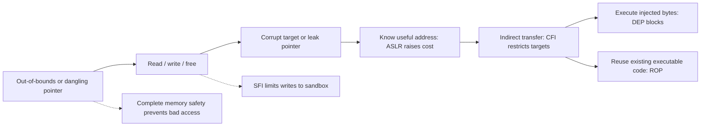
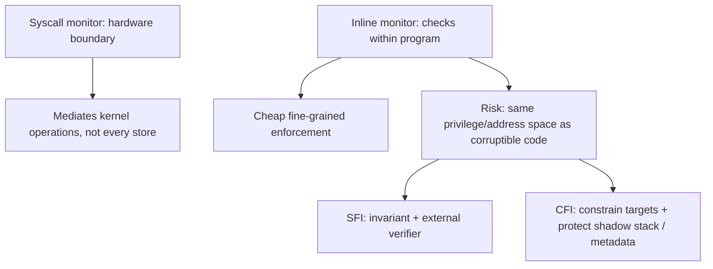
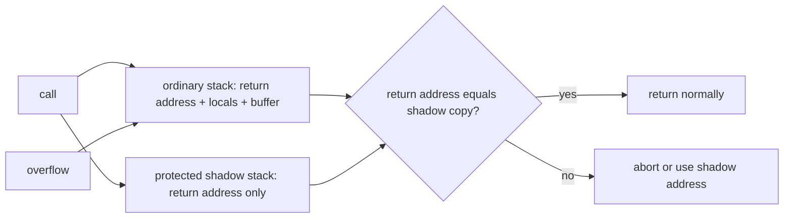

# Partial memory safety

> Source: [05 Partial Memory Safety](https://compsec.kisp-lab.org/Memory-Safety-Webbook/05-partial-memory-safety.dc.html), including interactive examples and references; builds on [Memory Exploits](https://compsec.kisp-lab.org/Memory-Safety-Webbook/03-control-flow-hijacking.dc.html). Examples illustrate mechanisms and bypasses, not universal ABI or deployment guarantees.

## 0. Exploit requirements and defenses

Code injection needs (1) a writable place for payload bytes, (2) permission to execute them, and (3) a diverted control transfer to them. Partial defenses block a route to one requirement without ensuring the original pointer access stays in bounds. In the [1A stack overflow](https://compsec.kisp-lab.org/Memory-Safety-Webbook/01a-spatial-memory-errors.dc.html#labs), unbounded `scanf` writes beyond `buf`, overwrites a saved return address, and `ret` executes shellcode placed in the buffer.



The interactive [mitigation ladder](https://compsec.kisp-lab.org/Memory-Safety-Webbook/05-partial-memory-safety.dc.html#mitig-group) applies one defense at a time to that overflow:

| State | What changes | Remaining attacker route |
|---|---|---|
| Nothing on | Write shellcode, overwrite return address, execute from stack; all three requirements met. | No extra work. |
| + Canary | Contiguous overwrite crosses secret and `__stack_chk_fail` aborts; the overflow has already occurred. | Write to chosen address with format-string `%n` or corrupted allocator links; avoid canary. |
| + DEP | Shellcode present, return address overwritten, but instruction fetch from writable stack faults: requirement 2 blocked. | Return to libc or chain existing gadgets (ROP). |
| + ASLR | Reused code still executable, but its address varies: requirement 3 needs knowledge. | Leak a pointer; alternatively guess/brute-force when restart model permits. |
| + CFI | Illegitimate gadget transfer not in computed control-flow graph (CFG): requirement 3 restricted. | Assemble a chain of permitted edges in an over-approximate CFG. |
| All on | The original `scanf` still writes, e.g. 60 bytes into a 50-byte array. | Find another path (including non-control-data corruption); full safety must address the bad access itself. |

## 1. [Defensive coding and bug-finding](https://compsec.kisp-lab.org/Memory-Safety-Webbook/05-partial-memory-safety.dc.html#coding)

* Check loop bounds, pass destination capacity, and use length-taking APIs. The bound must agree with the actual buffer declaration; that still depends on the programmer getting it right.
* Unbounded calls and bounded alternatives have distinct traps:

| Unbounded | Alternative | Caveat |
|---|---|---|
| `strcpy(dst, src)` | `strncpy` | If truncated, may omit NUL; subsequent `strlen` can run beyond the destination. |
| `strcat(dst, src)` | `strncat` | `n` means **bytes to append**, not total destination capacity; `sizeof(dst)` alone is wrong. |
| `gets(s)` | `fgets` | `gets` is inherently unsafe and removed in C11. |
| `sprintf(dst, fmt, ...)` | `snprintf` | Return is **bytes that would have been written**, not actual stored length; do not blindly index with it. |
| `scanf("%s", buf)` | `scanf("%49s", buf)` for `char buf[50]` | Width excludes NUL: at most 49 characters plus terminator. |

* Static tools inspect unexecuted paths but cannot see real inputs. [Flawfinder](https://dwheeler.com/flawfinder/) flags dangerous API names even when guarded, producing false positives; [Infer](https://fbinfer.com) composes procedure summaries across call sites (e.g. interprocedural null dereference). Pattern matching and semantic analysis offer different depths of analysis.
* [AddressSanitizer](https://www.usenix.org/system/files/conference/atc12/atc12-final39.pdf) instruments loads/stores at compile time and checks poisoned object redzones at runtime. It reports precisely on exercised paths, with almost no false alarms and roughly 2× overhead in this lecture; untested paths remain unknown. The slides call it static analysis, but its checks run at runtime.
* Advice and testing do not enforce safety in the shipped binary: one missed defect is enough.

## 2. [Stack canaries](https://compsec.kisp-lab.org/Memory-Safety-Webbook/05-partial-memory-safety.dc.html#canary)

* Compiler places a secret between local buffers and saved control data; on function exit, compare with trusted original and call `__stack_chk_fail` on mismatch, before `ret`. A **contiguous** overflow toward the return address must preserve or bypass it.
* Example x86-64 listing: `mov %fs:0x28,%rax` fetches a process secret from thread-local storage; `mov %rax,-0x8(%rbp)` saves it near the frame's top; after vulnerable `strcpy`, `xor %fs:0x28,%rax` tests equality (zero if equal), then conditional branch or `__stack_chk_fail`. `xor` also consumes the register copy. `gcc -fno-stack-protector` removes the instrumentation; the 1A lab disabled it. Compiler defaults and precise instruction layout vary.
* Three canary designs from [StackGuard](https://www.usenix.org/legacy/publications/library/proceedings/sec98/full_papers/cowan/cowan.pdf):
* **Terminator:** `\0 \n \r \xff` frustrate terminator-sensitive string copies but are public and offer no defense against `memcpy` or arbitrary writes.
  * **Random:** fresh secret on process initialization; leak or fork-reused secret enables disclosure/bytewise guessing attacks, subject to retry conditions.
  * **Random XOR:** secret combined with saved return address; changing either without corresponding update breaks check, including some partial-return-address overwrites.
* Canaries obstruct a route to requirement 3 without removing any of the three requirements. An arbitrary write can skip over the canary; corruption of local non-control data need not cross it.

## 3. [Guard pages and DEP](https://compsec.kisp-lab.org/Memory-Safety-Webbook/05-partial-memory-safety.dc.html#pages)

* Both use page-level MMU permissions, not object-level memory-safety checks.
* **Guard pages:** inaccessible pages beside a protected region cause a linear overflow to fault immediately. Chrome PartitionAlloc `/proc/<pid>/smaps` example: `---p` guard (`Size: 4 kB`, `Rss: 0 kB`), then `rw-p` allocation (`4 kB` resident), then `---p` guard (`8 kB`, `Rss: 0 kB`). Guard pages consume virtual address space/page tables, not necessarily physical RAM ([PartitionAlloc](https://chromium.googlesource.com/chromium/blink/+/master/Source/wtf/PartitionAlloc.h)).
* An attacker-controlled index `base+i` can jump over a guard without touching it; allocator unlink or another chosen-address write is non-contiguous. Page granularity also leaves accesses inside the permitted region unchecked.
* **DEP / NX / W⊕X:** writable data pages are not executable; executable code pages are not writable. Requirement 2 (executing injected shellcode) is removed, even if writing and redirection succeed. `execstack -s demo` marks a demo stack executable; `execstack -q demo` reports `X demo` for executable versus `-` for non-executable stack. **Bypass:** return to existing code / ret2libc / ROP ([ROP](https://compsec.kisp-lab.org/Memory-Safety-Webbook/03-control-flow-hijacking.dc.html#rop)). JITs must write machine code and then execute it; transitions/mappings require special handling and can expose exceptions to W⊕X.

## 4. [Address space layout randomization](https://compsec.kisp-lab.org/Memory-Safety-Webbook/05-partial-memory-safety.dc.html#aslr)

* Randomize bases at load time: stack, heap, shared libraries, and **main executable if PIE**; other mappings/data such as bss follow relevant placement, and heap layout can change as it grows. Does **not** prevent the overwrite: it removes knowledge of where to point a hijacked pointer. The example `buf @ 0x7fffffffe250` repeats with `setarch -R ./demo`, while normal runs give different `0x7ff...` addresses; `/proc/sys/kernel/randomize_va_space` controls Linux system policy. [PaX original design](https://pax.grsecurity.net/docs/aslr.txt).
* **Entropy matters:** 16 randomized bits = 65,536 guesses; [Shacham et al.](https://hovav.net/ucsd/dist/asrandom.pdf) broke a 32-bit Apache target in about 216 seconds with repeated trials. 64-bit layouts offer much more room, but actual entropy depends on region and platform.
* Bypass routes: (1) leak one pointer (format string, uninitialized read, Heartbleed) → derive fixed offsets within that region; (2) overwrite only low pointer byte(s), exploiting unchanged page offset (low 12 bits on 4 KiB pages); (3) reuse fixed-address code from a non-PIE main binary. Restart/brute-force depends on crash tolerance, rate, and whether forks reuse the same layout. DEP + ASLR together force code reuse and then obscure its addresses.

## 5. [Inline reference monitors (IRM)](https://compsec.kisp-lab.org/Memory-Safety-Webbook/05-partial-memory-safety.dc.html#irm)

[Part B introduction](https://compsec.kisp-lab.org/Memory-Safety-Webbook/05-partial-memory-safety.dc.html#irm-group): embed checks enforcing an explicit policy at each relevant operation.

* **Reference monitor:** observes each reference and decides if a policy permits it. Syscall interface mediates kernel objects behind a hardware privilege boundary, but cannot practically trap every user-space memory access. IRM inserts checks into code (compiler or binary rewriting), cheaply mediating finer-grained operations.
* Possible policies: complete memory safety; fault isolation; execute only pre-existing code; control-flow integrity; syscall restrictions; code-pointer or chosen-data integrity; data-flow integrity (reads only from permitted writes). **Mechanism ≠ policy:** stronger policy requires more precise checks.
* The checker, checked program, and checker metadata share privilege/address space. A memory-corrupting attacker might edit the check, jump over it, or forge its input. Each IRM design must explain why that cannot violate its specific invariant.



### 5.1 [Software fault isolation (SFI)](https://compsec.kisp-lab.org/Memory-Safety-Webbook/05-partial-memory-safety.dc.html#sfi)

* **Policy:** untrusted module may access only sandbox `M = [0xbe00, 0xbeff]`; attacker may still write **anywhere within M**. Naive `InRange(ebp)` call + branch before every `mov (ebp), eax` is expensive, and a control-flow jump can bypass a local check.
* [Wahbe et al.](https://cs155.stanford.edu/papers/sfi.pdf): coerce every address branchlessly instead of testing it and rejecting out-of-range values:

```asm
and reg1, 0x00ff      ; retain only offset
or  reg1, 0xbe00      ; force sandbox prefix
mov (reg1), eax       ; effective address always in M
```

| Interactive input | After `& 0x00ff` | After `| 0xbe00` | Interpretation |
|---|---|---|---|
| `0xbe42` | `0x0042` | `0xbe42` | Legal access unchanged. |
| `0xdead` (heap pointer) | `0x00ad` | `0xbead` | Heap target redirected into M. |
| `0x08048000` (code) | `0x0000` | `0xbe00` | Code address loses high bits. |
| `0xbffff7c0` (return-address target) | `0x00c0` | `0xbec0` | Still writes, but into M. |

* **Skip-the-mask attack:** jumping directly to `mov` bypasses the preceding AND/OR if the access uses an arbitrary writable register. Reserve a dedicated register for every memory access, allowing only sandbox-coercing sequences to write it. Then even jumping into the load/store uses a value already constrained to M (assuming initialized register and genuinely unskippable write discipline). Cost: two operations per access and one fewer general-purpose register, painful on 32-bit x86.
* Independently **verify the binary**: approved masking sequences, all accesses through reserved register, no other writes to it (and safe control-flow/initialization conditions). The compiler need not be trusted: a small verifier is the trusted computing base (TCB), not the potentially huge generator. Fault isolation limits blast radius, not the module's own internal memory errors. [Native Client](https://research.google/pubs/native-client-a-sandbox-for-portable-untrusted-x86-native-code/) deployed SFI in browsers; WebAssembly linear memory offers a related sandbox bargain.

<details>
<summary>Branchless masking and reserved-register checks</summary>

- The example `addr & 0x00ff | 0xbe00` maps any input into `0xbe00..0xbeff`. This **constrains the address value**, not the application's understanding of what object it intended to use.
- If code can jump directly to the load/store instruction, a preceding check or mask may be skipped. Reserving a register and verifying that *only* mask sequences write it means even a jump to the store uses a previously confined address. The register must be initialized safely; indirect control flow and alternative instructions must not escape verification.
- A separate verifier checking **machine code**, not source, reduces trust in the compiler. It must validate every memory operation and every possible write to the reserved register; otherwise a single bypass defeats the sandbox. [SFI source](https://compsec.kisp-lab.org/Memory-Safety-Webbook/05-partial-memory-safety.dc.html#sfi).

</details>

### 5.2 [Control-flow integrity (CFI)](https://compsec.kisp-lab.org/Memory-Safety-Webbook/05-partial-memory-safety.dc.html#cfi)

* **Policy:** every runtime control transfer follows an edge in the compiler's CFG ([Abadi et al.](https://doi.org/10.1145/1102120.1102165)). Direct branches have encoded destinations; checks target **indirect** calls, computed jumps, and returns. If exactly one legal target, compare pointer with expected address; multiple targets make per-target comparisons costly.
* **Tag scheme:** mark each acceptable destination with a tag identifying an allowed equivalence class; indirect branch checks destination's tag, skips tag word, then branches. Illustrative code:

```asm
cmp [ecx], 0x12345678   ; expected destination tag (wide random build-time value)
jne error_label
lea ecx, [ecx+4]       ; skip four-byte tag
jmp ecx
```

* `sort()` comparator example: short class tag `17` means `lt()` and `gt()` are both legal; `sort()` has tag `55` and is rejected from that call site; `system()` has no matching tag (example prologue word `0x8b485ed1`) and is rejected. An application that **actually** calls only `lt()` may nevertheless be allowed to call `gt()` if analysis puts both in its class. The readable tags 17/23/55 are diagram labels, not real secure secret values; executable integrity and protecting tag/check instructions are also required.
* **Returns:** a general return site has many possible caller sites, so coarse tagging admits wrong-caller returns and ROP. **Shadow stack** copies each return address on call to separate storage containing no buffers/locals, then on return either (a) compares and aborts on mismatch (**detect**) or (b) returns using trusted shadow copy (**repair**). Ordinary stack may contain `0x41414141` while shadow copy retains `0x004017a2`. Shadow memory must itself be protected, e.g. by placing it outside an SFI sandbox; hardware-enforced shadow stacks offer another boundary.

<details>
<summary>CFI tag classes and protected return addresses</summary>

- A forward indirect call through `ecx` checks that its destination begins with the expected tag. Grouping `lt()` and `gt()` under one tag means the check permits **either**, even if this particular execution only intended one. A tag is an equivalence-class marker, not an address or a proof of the call's semantics.
- Returns require matching a specific *dynamic* caller, not merely a set of legal destination tags. A shadow stack saves each return address outside ordinary writable frame data; compare the normal return slot to its shadow copy (detect corruption), or use the protected copy (repair). Protect the shadow region/check itself against arbitrary writes and skipping.
- CFI enforces allowed graph edges, not full path histories; an allowed-edge chain can remain malicious. Even perfect control-edge checks leave non-control data corruption possible. [CFI source](https://compsec.kisp-lab.org/Memory-Safety-Webbook/05-partial-memory-safety.dc.html#cfi).

</details>



* Legitimate sequences `A→B→D`, `A→C→D`, `A→B→C` yield directed edges `A→B`, `A→C`, `B→D`, `C→D`, `B→C`; `A→D` fails on its first edge, `A→C→B→D` on `C→B`. Edge checking is stateless: any sequence made solely of allowed edges passes even if that full sequence is impossible in normal execution.
* Precisely finding indirect targets requires pointer analysis, undecidable in general and necessarily conservative in practice: missing legal edge breaks functionality; extra edges enlarge attacker freedom. Coarse equivalence classes admit permitted-edge gadget chains ([Carlini & Wagner](https://www.usenix.org/system/files/conference/usenixsecurity14/sec14-paper-carlini.pdf)). CFI constrains requirement 3 but does not repair corrupted data or prevent leaks.
* Deployed examples: [Clang `-fsanitize=cfi`](https://clang.llvm.org/docs/ControlFlowIntegrity.html) checks applicable indirect targets using type information; [Microsoft CFG `/guard:cf`](https://learn.microsoft.com/en-us/windows/win32/secbp/control-flow-guard) checks valid indirect-call targets in a bitmap. Intel CET offers hardware shadow stack and `endbr64` indirect branch tracking (coarse destination marker); Arm pointer authentication and BTI are related hardware mitigations, not identical implementations.

## 6. [Six attack stages](https://compsec.kisp-lab.org/Memory-Safety-Webbook/05-partial-memory-safety.dc.html#taxonomy)

Adapted from [Szekeres et al., SoK: Eternal War in Memory](https://nebelwelt.net/publications/files/13Oakland.pdf). Each band interrupts a *particular* route, not necessarily all outcomes (code corruption, control-flow hijack, data-only attack, information leak):

| Stage | Attacker action | Possible cut |
|---:|---|---|
| 1 | Make pointer out of bounds or dangling. | **Complete memory safety** (next lecture). |
| 2 | Use pointer to write, free or read. | **Complete memory safety**. |
| 3 | Change code, code pointer, data pointer or data value. | Code integrity; code-pointer integrity; data integrity. |
| 4 | Aim at attacker-chosen code/gadget/value. | ASLR; instruction-set randomization; data-space randomization. |
| 5 | Use corrupted pointer in call, jump, return. | CFI; data-flow integrity. |
| 6 | Execute gadget or injected code. | Non-executable data/DEP; instruction-set randomization. |

* Canaries and guard pages have no band in the table: they interfere with a *contiguous path* between use and corruption, not a general policy. Indexing/arbitrary writes step around them. SFI confines module accesses but does not stop an in-sandbox bug; defensive coding and testing can remove bugs but do not enforce a runtime policy.
* Cutting stage 6 prompts ROP; stage 4 prompts an information leak; stage 5 prompts legal-edge abuse. Stages 1 and 2 remain possible unless a memory-safety mechanism prevents the invalid access. See [summary](https://compsec.kisp-lab.org/Memory-Safety-Webbook/05-partial-memory-safety.dc.html#summary) and [full memory safety](https://compsec.kisp-lab.org/Memory-Safety-Webbook/06-full-memory-safety.dc.html).

## 7. Further reading

The chapter's [references](https://compsec.kisp-lab.org/Memory-Safety-Webbook/05-partial-memory-safety.dc.html#references) include all 14 works linked at their corresponding topics above: [Flawfinder](https://dwheeler.com/flawfinder/), [Infer](https://fbinfer.com), [ASan](https://www.usenix.org/system/files/conference/atc12/atc12-final39.pdf), [StackGuard](https://www.usenix.org/legacy/publications/library/proceedings/sec98/full_papers/cowan/cowan.pdf), [PartitionAlloc](https://chromium.googlesource.com/chromium/blink/+/master/Source/wtf/PartitionAlloc.h), [PaX ASLR](https://pax.grsecurity.net/docs/aslr.txt), [ASLR effectiveness](https://hovav.net/ucsd/dist/asrandom.pdf), [SFI](https://cs155.stanford.edu/papers/sfi.pdf), [Native Client](https://research.google/pubs/native-client-a-sandbox-for-portable-untrusted-x86-native-code/), [CFI](https://doi.org/10.1145/1102120.1102165), [ROP vs CFI](https://www.usenix.org/system/files/conference/usenixsecurity14/sec14-paper-carlini.pdf), [Clang CFI](https://clang.llvm.org/docs/ControlFlowIntegrity.html), [Windows CFG](https://learn.microsoft.com/en-us/windows/win32/secbp/control-flow-guard), [Eternal War](https://nebelwelt.net/publications/files/13Oakland.pdf).
