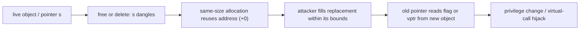

# Temporal Memory Errors

> Source: [02 Temporal Memory Errors](https://compsec.kisp-lab.org/Memory-Safety-Webbook/02-temporal-memory-errors.dc.html), including inline interactive state and all 12 lab levels. Companion: [spatial notes](spatial-1a1b.md) · [memory exploits](exploits-3.md). Numbers in exercises are specific to Ubuntu 22.04, GCC 11.4, glibc 2.35.

Source sections: [scope/lifetime](https://compsec.kisp-lab.org/Memory-Safety-Webbook/02-temporal-memory-errors.dc.html#lifetime) · [definition](https://compsec.kisp-lab.org/Memory-Safety-Webbook/02-temporal-memory-errors.dc.html#concept) · [UAF](https://compsec.kisp-lab.org/Memory-Safety-Webbook/02-temporal-memory-errors.dc.html#uaf) · [UAF exploitation](https://compsec.kisp-lab.org/Memory-Safety-Webbook/02-temporal-memory-errors.dc.html#uaf-exploit) · [summary](https://compsec.kisp-lab.org/Memory-Safety-Webbook/02-temporal-memory-errors.dc.html#summary).

## 1. Scope, lifetime, undefined behavior

* **Scope** is the source-text region where an identifier is visible; **lifetime** is the execution interval when its object's storage is reserved. The CPU/ISA enforces neither. C11 [§§6.2.1, 6.2.4, 7.22.3.3](https://www.open-std.org/jtc1/sc22/wg14/www/docs/n1570.pdf).
* In `int z; int g(int x,int y) { char *buf=malloc(50); scanf("%s",buf); free(buf); {int w=0;} }`: `z` and literal `"%s"` live for program duration; `x,y,buf` for invocation of `g`; `w` for inner block; **allocated `*buf` only from `malloc` to `free`**, despite `buf` remaining in scope. The pointer's value becomes indeterminate when its referent's lifetime ends.
* `int *p; { int x=5; p=&x; } return *p;` accesses dead automatic `x`: **undefined behavior**, not reliably 5, 0, or a compile-time error. Storage may be reused; observations depend on compiler/optimization/environment. **Temporal = wrong time**; spatial = outside bounds/wrong place.

## 2. Use-after-free (CWE-416)

* `free(s)` ends the heap object's lifetime but does not erase its bytes or automatically rewrite aliases. A dangling pointer may now address a *different* live allocation at precisely the same address. Reading/writing through it is a UAF even if the new allocation's bounds are respected; a spatial bounds check on the new write would not help. [CWE-416](https://cwe.mitre.org/data/definitions/416.html) ranked second in [MITRE's 2025 KEV top 10](https://cwe.mitre.org/top25/archive/2025/2025_kev_list.html).
* Browser illustration: `Document::child` points to a `Body` in the DOM; free/remove the `Body` without clearing `child`; use `doc->child->getAlign()` later. Heap grooming (Sotirov's [heap feng shui](https://blackhat.com/presentations/bh-europe-07/Sotirov/Presentation/bh-eu-07-sotirov-apr19.pdf)) arranges for attacker-shaped data to be allocated into that freed slot. Virtual method dispatch reads the object's vtable pointer, then the chosen function-pointer entry: a controlled replacement can redirect the call. The attacker need not insert any new executable instructions. [DOM](https://developer.mozilla.org/en-US/docs/Web/API/Document_Object_Model/Introduction); [C++ layout](https://www.seclab.cs.sunysb.edu/sekar/cse307/ln/oop.txt).

* ASLR randomizes heap and (for PIE) program code, so addresses for forged vtables/functions must be learned **from the current process**, not hard-coded from a previous run. `objdump -t`, `readelf -SW` and `readelf -lW` distinguish symbol section flags from effective mapped permissions. A C++ vtable in `.data.rel.ro` is writable during relocation then read-only under `GNU_RELRO`; alter the writable *object's vptr*, not the protected real table. [ASLR](https://docs.kernel.org/admin-guide/sysctl/kernel.html); [GNU ld RELRO](https://sourceware.org/binutils/docs/ld/Options.html).
* Nulling one dangling pointer after free makes this particular silent misuse a deterministic null dereference (crash), but other aliases can remain; automatic [dangling-pointer nullification](https://www.ndss-symposium.org/wp-content/uploads/2017/09/05_1_2.pdf) must find them all. UAFs recur in [browser 0-days](https://googleprojectzero.github.io/0days-in-the-wild/rca.html); Chromium reports [~70% of serious bugs are memory-safety related](https://www.chromium.org/Home/chromium-security/memory-safety/).
* Embedded review case: `p_name=p->name; free(p); p=NULL; free(p); printf("%s",p_name);` — `free(NULL)` is harmless, but **`p_name` still dangles**, and a subsequent `p->age` would dereference null. Removing the alias read and checking `p` before dereference fixes those paths; clearing one owner alone does not clear aliases. The DOM interactive explicitly links `Document → Body → Div`; `delete body` leaves `doc->child` non-null, so its guard passes before a stale virtual call.

## 3. Heap mechanics relevant to double-free

* glibc free chunks reuse former user bytes as free-list links; **allocated** chunks have size metadata but are not in a master list. Classic doubly linked list unlink of `p` is `p->next->prev=p->prev; p->prev->next=p->next;` (`fd/bk` in allocator terminology). In an old allocator, spoiling both pointers can turn unlink into writes to chosen addresses. `free` inserts; a later `malloc` removes/unlinks. Classic [Vudo](https://phrack.org/issues/57/8) and [Once upon a free()](https://phrack.org/issues/57/9) describe historical attacks rather than today's ordinary small-chunk path.
* Modern paths first use size-class **tcache** (per thread, introduced glibc 2.26; default seven entries/bin on lab glibc 2.35), then **fastbins** when tcache full. Both are singly linked and reuse data bytes; requests of different size classes do not necessarily reuse the same slot. Which check applies depends on existing bin occupancy. glibc 2.29 checks tcache duplicate entries, fastbin checks whether the chunk is already its **head**, and glibc 2.3.4 added reciprocal-link checks to unlink. Since glibc 2.32, safe-linking XOR-masks singly linked next pointers and validates alignment: `stored_next = (address_of_next_field >> 12) ^ actual_next`. See [glibc 2.35 malloc.c](https://sourceware.org/git/?p=glibc.git;a=blob;f=malloc/malloc.c;hb=refs/tags/glibc-2.35) and [Safe-Linking](https://research.checkpoint.com/2020/safe-linking-eliminating-a-20-year-old-malloc-exploit-primitive/).

Freed-chunk links and safe-linking

- `malloc(n)` returns a user pointer into a physical chunk with size metadata. After `free`, allocator bookkeeping may overwrite that chunk's **former user bytes**; treating them as an intact old object is a temporal error. The physical chunk chain and logical tcache/fastbin list are different structures.
- For this glibc's tcache, `next` points to another **user pointer** of the same size class; for fastbins, `fd` uses the allocator's chunk-pointer convention. Check which list receives a chunk before interpreting an apparent leaked pointer or building a link value.
- Safe-linking stores `protected = (address_of_link_field >> 12) ^ next`, not a raw `next`. At an aligned chunk whose link is at its user address `z`, a null `next` appears as `z >> 12`; to decode, XOR the stored value with `z >> 12`. This is **not encryption**: knowing the field's address yields the mask; glibc also checks alignment.
- The default tcache bin capacity (seven here), fastbin checks, link alignment, arena choice and pop order are implementation/version/state-specific. [Chapter 2 allocator section](https://compsec.kisp-lab.org/Memory-Safety-Webbook/02-temporal-memory-errors.dc.html#heap).

## 4. Double-free (CWE-415): two owners, then a write primitive

* `free(p); ... free(p)` is undefined behavior ([CWE-415](https://cwe.mitre.org/data/definitions/415.html)). Conceptual `a=malloc(S); b=malloc(S); free(a); free(b); free(a); x=malloc(S); y=malloc(S); z=malloc(S)` can return `x==z`: *two apparently valid owners of one chunk*. One writes in bounds and the other observes changes, or one frees and the other corrupts the now-free allocator link. This is **not automatically** the classic doubly linked-list unlink: that requires a separately spoiled free chunk already on that list.
* As written, `free(a),free(b),free(a)` usually aborts with `free(): double free detected in tcache 2` (or, for larger non-fastbin chunks, `double free or corruption (!prev)`). A fastbin only compares the current head; alternating `a,b,a` can bypass that check **if seven prior same-size frees fill tcache** on the pinned glibc. Newer allocator versions can block even this route. A duplicate pop may move remaining fastbin entries into tcache, so a later corrupted link may be **tcache `next` (user pointer)** rather than fastbin `fd` (different convention).
* A duplicated owner writes to a chunk after the other owner frees it; overwrite free tcache `next` with `(z >> 12) ^ target` (here next field begins at `z`), then allocation consumes the edited chunk and returns the 16-byte-aligned **user pointer** `target` on a subsequent `malloc`; an in-bounds write there is effectively write-anything-anywhere. A raw unencoded target fails safe-linking/alignment. In the lab target is `&secret[2]`, value `0x4141414141414141`; 8 payload bytes for encoded pointer and 8 for value. No overwritten return address, and successful runs exit 0.

The A–B–A sequence with a full tcache

- Empty tcache: `free(a)` inserts A; `free(b)` inserts B; a second `free(a)` is detected by tcache duplicate checking and aborts—do **not** infer that alternating names always bypasses double-free checks.
- In the pinned lab, seven prior same-size frees fill that thread's tcache. Later `free(a),free(b),free(a)` goes to fastbins, where the immediate-head comparison sees B rather than A on the final call. This can create duplicate paths to one physical chunk; subsequent fastbin pops may transfer remaining entries into tcache.
- A duplicated user pointer allows one apparent owner to free/relink the chunk while another still writes to it. That write can replace the tcache link; a later allocation consumes the edited link and the following allocation may return the chosen aligned target. Exact allocation count/order and whether newer glibc rejects the sequence must be measured, not extrapolated. [Chapter 2 double-free](https://compsec.kisp-lab.org/Memory-Safety-Webbook/02-temporal-memory-errors.dc.html#doublefree).

## 5. Lab: three programs / twelve levels

* [Lab section](https://compsec.kisp-lab.org/Memory-Safety-Webbook/02-temporal-memory-errors.dc.html#labs): `gcc -g -w -o session session.c`, `g++ -g -w -o node node.cpp`, `gcc -g -w -o dfree dfree.c`; [OnlineGDB session](https://onlinegdb.com/NRczIc-ea), [node](https://onlinegdb.com/EFDZx_lxk), [dfree](https://onlinegdb.com/yBEQALea9). Nine levels work in browser; 7/8/12 require shell, disassembly or raw-byte scripts. Change source only at levels 3/4. Beware VM/version-specific addresses, bins and offsets. [VM/lab zip](https://compsec.kisp-lab.org/lab/memory-safety-lab-02.zip) ([checksum](https://compsec.kisp-lab.org/lab/memory-safety-lab-02.zip.sha256)): unzip, `vagrant up`, `vagrant ssh`, work under `/vagrant/src`; x86-64 Ubuntu 22.04/GCC 11.4/glibc 2.35, with GDB/pwndbg/pwntools. OnlineGDB can differ.
* **Program 1 `session`**: `struct session {char user[32]; int privileged;}` (`sizeof=36`); `s=malloc(sizeof *s)`, initialized as `alice`/flag 0; `free(s)`; `note=malloc(sizeof *s)`; unbounded `scanf("%s",note)`; mistakenly print `s->user,s->privileged`. (1) Freed `s`, still-held pointer and new `note` show same address (`+0`); (2) shortest `33` nonzero characters sets first flag byte to `A=65`, prints ADMIN, exit 0; 34 `A`s produce `0x4141=16705`; all 33 chars belong to new note. (3) Changing note allocation to `malloc(64)` gives different size bin and no reuse (lab observed `+4160`, incidental), flag remains 0. (4) `s=NULL` immediately after free produces segfault/status 139 instead of false success/status 0; only protects this alias.
* **Program 2 `node`**: `struct Node { virtual void render(); char text[24]; }`, `void pwned()` never called; `new Node`, print `node` and `pwned`, `delete n`, allocate `new char[sizeof(Node)]`, zero it, `read(0,buf,sizeof(Node))`, erroneously `n->render()`. (5) `sizeof(Node)=32`, `text` at `+8`, vptr in first eight bytes, reuse offset `+0`. (6) Eight raw `A`s (not a typed line; e.g. Python binary stdout) set vptr `0x4141414141414141`; crashes at later virtual call while **reading first table entry** (`mov (%rax),%rdx`), not when writing and not after jumping to code. (7) `_ZTV4Node` in `.data.rel.ro` / `GNU_RELRO`, effective `r--p`; don't edit real table. (8) raw **16-byte payload** `p64(buf+8) + p64(pwned)` builds table inside user buffer: first word is fake table pointer, next its first entry. `pwned()` prints, process exits 0. Dynamically obtain `buf,pwned` for this run.
* **Program 3 `dfree`**: aligned `static uint64_t secret[8]`, 64-byte chunks `a,b`; allocate/free `n` warm-up chunks; `free(a);free(b);free(a)`; drain warmups then allocate `x,y,z`; `free(x)`; read eight bytes into still-live `z`; allocate once, then `w=malloc(64)` and read eight bytes into `w`. (9) `n=0` triggers `free(): double free detected in tcache 2`, abort status 134. (10) smallest successful `n=7` fills tcache; `n<=6` detected; `a,b,a` evades fastbin head comparison on glibc 2.35. (11) `x==z`; first fastbin allocation stashes remainder in tcache, hence `y,z` come from tcache. (12) encode `(z>>12) ^ &secret[2]` into `edit z`, then write eight `A` bytes at `write w`: `w==&secret[2]`, target value changes, exit 0; target alignment and current-run addresses essential. On newer glibc the earlier fastbin route may be closed.

## 6. Takeaways / references

* Spatial errors access the wrong **place**; temporal errors access at the wrong **time**. Both can produce control-flow hijack or data-only compromise. A crash is not proof of exploit: the successful virtual-call and arbitrary-write levels exit quietly; a crash often marks a failed payload or defense. C/C++ and hardware alone do not enforce the intended object lifetime.
* Further reading: [C11 draft](https://www.open-std.org/jtc1/sc22/wg14/www/docs/n1570.pdf), [glibc internals](https://sourceware.org/git/?p=glibc.git;a=blob;f=malloc/malloc.c;hb=refs/tags/glibc-2.35), [heap feng shui](https://blackhat.com/presentations/bh-europe-07/Sotirov/Presentation/bh-eu-07-sotirov-apr19.pdf), [safe-linking](https://research.checkpoint.com/2020/safe-linking-eliminating-a-20-year-old-malloc-exploit-primitive/), [Project Zero cases](https://googleprojectzero.github.io/0days-in-the-wild/rca.html).
